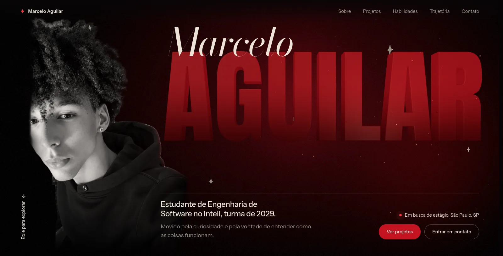
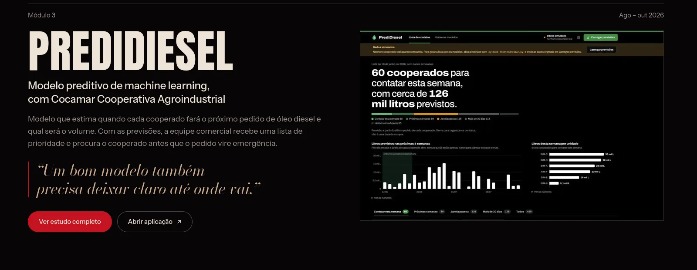
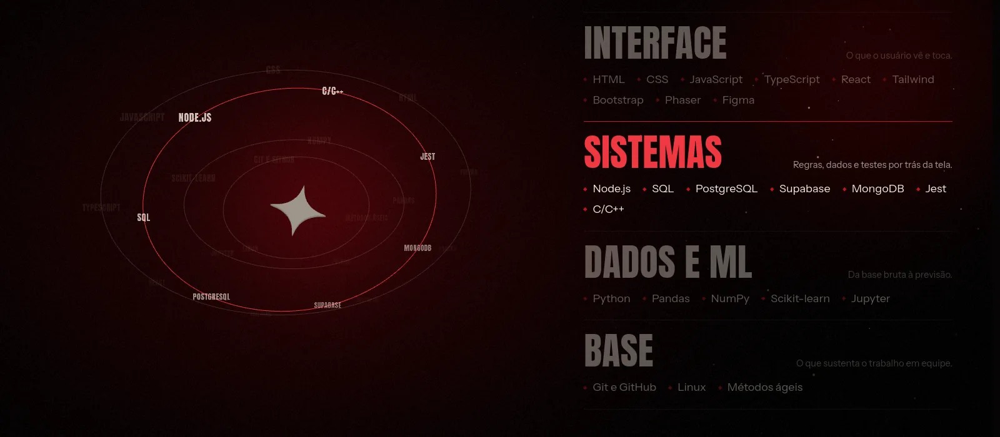
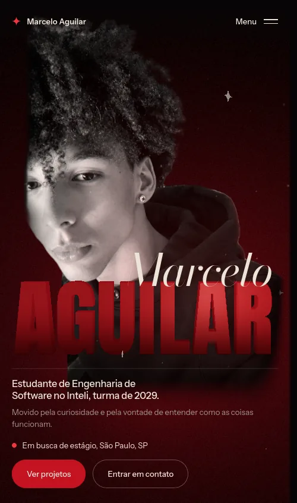
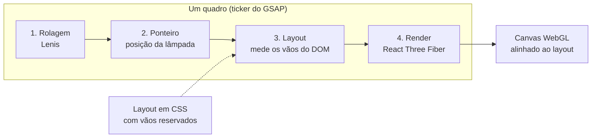
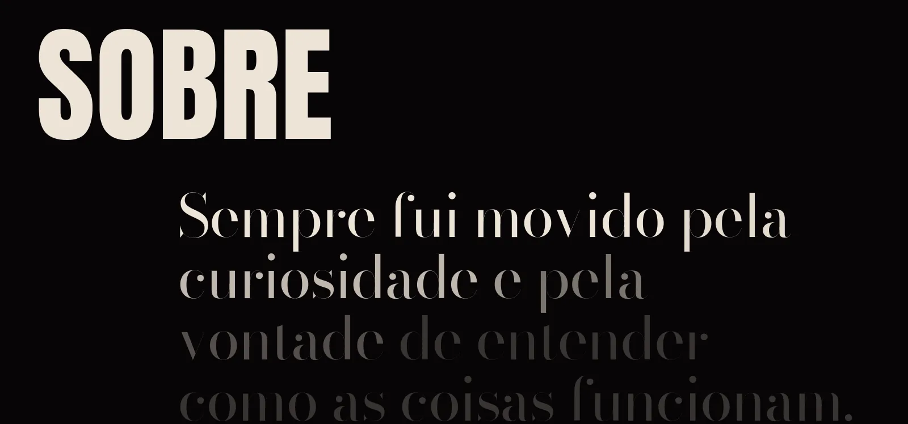

<div align="center">

# Marcelo Aguilar · Portfólio 3D

**Portfólio interativo em 3D. O cursor é uma lâmpada que ilumina a cena em tempo real.**

Estudante de Engenharia de Software no [Inteli](https://www.inteli.edu.br/), turma de 2029 · São Paulo, SP

[](https://react.dev/)
[](https://www.typescriptlang.org/)
[](https://threejs.org/)
[](https://vite.dev/)
[](https://gsap.com/)
[](https://portifolio-pessoal-kohl.vercel.app)

### [Ver o site ao vivo →](https://portifolio-pessoal-kohl.vercel.app)

<br />

<a href="https://portifolio-pessoal-kohl.vercel.app">
  
</a>

</div>

<br />

## Sumário

- [Sobre o projeto](#sobre-o-projeto)
- [Destaques](#destaques)
- [Galeria](#galeria)
- [Projetos apresentados](#projetos-apresentados)
- [Tecnologias](#tecnologias)
- [Como rodar localmente](#como-rodar-localmente)
- [Arquitetura](#arquitetura)
- [Performance e acessibilidade](#performance-e-acessibilidade)
- [Design](#design)
- [Editando o conteúdo](#editando-o-conteúdo)
- [Deploy](#deploy)
- [Contato](#contato)
- [Licença](#licença)

## Sobre o projeto

Este repositório contém o meu portfólio pessoal: uma página única, construída do zero com React e
three.js, que apresenta quem eu sou, os projetos que desenvolvi com parceiros reais no Inteli, as
minhas habilidades e a minha trajetória.

A ideia central é simples: **o visitante segura uma lâmpada**. O cursor é uma fonte de luz real que
reilumina o retrato em relevo, as letras extrudadas do sobrenome e a poeira em suspensão. Ao rolar a
página, o sobrenome se ergue na abertura, tomba quando a seção "Sobre" sobe como uma cortina e volta
inteiro no encerramento.

Todo o conteúdo vem do meu currículo e do meu perfil no LinkedIn. Nenhum projeto, experiência ou
prêmio foi inventado.

## Destaques

| | |
| --- | --- |
| **Luz que segue o cursor** | Uma luz pontual acompanha o ponteiro e reilumina a cena 3D. Sobre o texto, ela continua como um halo discreto. |
| **Layout em CSS, 3D encaixado** | Cada seção reserva "vãos" no DOM e a cena 3D se encaixa neles a cada quadro. A responsividade é resolvida uma única vez, no CSS. |
| **Paralaxe real** | A câmera usa projeção fora do eixo: a tela funciona como uma janela e os objetos ganham profundidade quando o cursor se move. |
| **Narrativa ligada à rolagem** | Abertura coreografada, revelação de textos e transições entre seções com GSAP ScrollTrigger e SplitText. |
| **Baralho de projetos** | Cada projeto vira uma carta 3D, com estudo de caso completo em uma janela de diálogo acessível. |
| **Habilidades em órbita** | As tecnologias giram em quatro órbitas, e o sistema pode ser arrastado para girar. |
| **Funciona em qualquer lugar** | Sem WebGL, com movimento reduzido ou se a cena falhar, o site cai para a mesma composição em CSS. |

## Galeria

<table>
  <tr>
    <td width="70%" valign="top">
      
      <br /><br />
      
    </td>
    <td width="30%" valign="top">
      
    </td>
  </tr>
  <tr>
    <td align="center"><sub>Projetos e habilidades no desktop</sub></td>
    <td align="center"><sub>Tela inicial no celular</sub></td>
  </tr>
</table>

## Projetos apresentados

O portfólio reúne os três projetos que desenvolvi em equipe no Inteli, cada um em dez semanas e com
um parceiro real:

| Projeto | Parceiro | O que é | Stack |
| --- | --- | --- | --- |
| **[PrediDiesel](https://g04-e862d3.pages.git.inteli.edu.br/)** | Cocamar | Modelo de machine learning que prevê quando e quanto cada cooperado vai pedir de óleo diesel, gerando uma lista de prioridade para a equipe comercial. Treinado com mais de 65 mil pedidos. | Python, Pandas, Scikit-learn, Jupyter |
| **[Stamina](https://inteli-stamina.vercel.app/)** | Red Bull | Aplicação web que substitui as pranchetas dos fiscais do Red Bull 24 Horas, com placar quase em tempo real, histórico auditável e sincronização offline. | Node.js, TypeScript, Supabase, PostgreSQL, Jest |
| **[TimeRush](https://graduacao.pages.git.inteli.edu.br/2026-1a/t27/g05/)** | Unifesp | Jogo educativo de História para estudantes com baixa visão e limitações motoras, jogável apenas com o movimento dos olhos (eye tracker). | JavaScript, Phaser |

## Tecnologias

| Tecnologia | Uso no projeto |
| --- | --- |
| [React 19](https://react.dev/) + [TypeScript](https://www.typescriptlang.org/) | Base da aplicação e tipagem |
| [Vite 8](https://vite.dev/) | Servidor de desenvolvimento e build |
| [three.js](https://threejs.org/), [@react-three/fiber](https://r3f.docs.pmnd.rs/), [@react-three/drei](https://drei.docs.pmnd.rs/) | Cena 3D e integração com o React |
| [GSAP](https://gsap.com/) (ScrollTrigger, SplitText) | Abertura, revelação de textos e animações ligadas à rolagem |
| [Lenis](https://lenis.darkroom.engineering/) | Rolagem suave (desligada com movimento reduzido) |
| [Fontsource](https://fontsource.org/): Anton, Bodoni Moda, Instrument Sans | Fontes servidas localmente, sem requisições externas |
| [opentype.js](https://opentype.js.org/) (dev) | Conversão da fonte Anton em geometria para as letras 3D |
| [oxlint](https://oxc.rs/docs/guide/usage/linter) (dev) | Lint |

## Como rodar localmente

### Pré-requisitos

- **Node.js 24.x** (definido em `engines` no `package.json`; o Vite 8 exige no mínimo a versão 20.19)
- **npm** (vem com o Node.js)

<details>
<summary>Não tem o Node.js instalado? Instale com o nvm (Linux/macOS, sem sudo)</summary>

```bash
curl -o- https://raw.githubusercontent.com/nvm-sh/nvm/v0.40.3/install.sh | bash
source ~/.bashrc
nvm install 24
```

</details>

### Instalação

```bash
# 1. Clone o repositório
git clone https://github.com/marcelo-aguilar/Portif-lio-3D.git
cd Portif-lio-3D

# 2. Instale as dependências
npm install

# 3. Inicie o servidor de desenvolvimento
npm run dev
```

Abra [http://localhost:5173](http://localhost:5173). A página recarrega sozinha ao salvar um arquivo.

### Scripts disponíveis

| Comando | Descrição |
| --- | --- |
| `npm run dev` | Servidor de desenvolvimento em `http://localhost:5173` |
| `npm run build` | Verifica os tipos e gera a versão de produção em `dist/` |
| `npm run preview` | Serve a pasta `dist/` em `http://localhost:4173` para conferir o build |
| `npm run typecheck` | Apenas a verificação de tipos (TypeScript) |
| `npm run lint` | Lint com oxlint |
| `npm run typeface` | Regenera as letras 3D do sobrenome (só é necessário ao mudar a fonte ou o texto) |

### Testando os modos alternativos

Alguns parâmetros de URL forçam os caminhos alternativos da aplicação, o que facilita testar sem
mudar de dispositivo:

| URL | Efeito |
| --- | --- |
| `/?gl=0` | Simula um navegador sem WebGL (composição equivalente em CSS) |
| `/?motion=0` | Simula `prefers-reduced-motion` (rolagem nativa, sem animações contínuas) |
| `/?tier=low` | Força a cena simplificada usada em celulares |

## Arquitetura

### Estrutura de pastas

```
.
├── public/                  Arquivos estáticos (favicon, robots.txt)
├── scripts/
│   ├── build-typeface.mjs   Gera as letras 3D e as métricas a partir da fonte Anton
│   └── portrait/            Pipeline de recorte do retrato (Python)
├── docs/screenshots/        Imagens usadas neste README
└── src/
    ├── content/             Textos e dados: perfil, projetos, habilidades e trajetória
    ├── sections/            Seções da página (Hero, About, Projects, Skills, Journey, Contact)
    ├── ui/                  Interface compartilhada (navegação, abertura, ícones, halo da lâmpada)
    ├── three/               Cena 3D (câmera, letras, retrato em relevo, baralho, órbitas, atmosfera)
    ├── lib/                 Sistemas: laço de animação, rolagem, ponteiro, ponte DOM ↔ 3D
    ├── styles/              Design tokens e estilos base
    └── assets/              Imagens otimizadas (WebP) e a fonte das letras 3D
```

### Como o 3D se encaixa no layout

O layout inteiro é definido em CSS. Cada seção reserva "vãos" vazios (o retrato, o sobrenome, o
palco dos projetos, as órbitas) e, a cada quadro, a cena 3D mede esses vãos e se posiciona dentro
deles ([`src/lib/stage.ts`](src/lib/stage.ts)). O código WebGL nunca manipula o DOM.

A câmera usa projeção fora do eixo ([`src/three/Rig.tsx`](src/three/Rig.tsx)): o que está no plano
da tela fica alinhado ao layout, e o resto ganha paralaxe real quando o cursor se move.

Tudo roda em **um único `requestAnimationFrame`**, o do GSAP, em ordem determinística
([`src/lib/ticker.ts`](src/lib/ticker.ts)). Isso evita que a cena WebGL fique um quadro atrás do DOM:



## Performance e acessibilidade

**Performance**

- A cena 3D fica em um chunk separado, carregado sob demanda: o conteúdo aparece sem esperar o 3D.
- Renderização sob demanda: o canvas não desenha (e fica oculto) quando nenhum palco 3D está visível
  ou quando a aba está em segundo plano.
- Resolução (DPR) limitada a 1,75 no desktop e 1,5 no celular, reduzida automaticamente se os
  quadros ficarem lentos.
- Celulares recebem malhas mais leves, menos partículas e nenhum antisserrilhamento.
- Imagens em WebP, fontes servidas localmente e cache de longo prazo (`immutable`) para `/assets`.

**Acessibilidade**

- Link para pular direto ao conteúdo e foco sempre visível.
- Menu e estudo de caso operáveis pelo teclado (`Esc` fecha).
- Todo o texto existe no DOM; o 3D é decorativo e marcado com `aria-hidden`.
- `prefers-reduced-motion` respeitado: rolagem nativa e nenhuma animação contínua.
- Sem WebGL, a mesma composição é montada em CSS; sem JavaScript, um cartão com os contatos.

## Design



**Paleta.** Preto quente, um único vermelho em três profundidades e o bege das serifadas. Sem azul
nem neon.

| Token | Cor | Uso |
| --- | --- | --- |
| `breu` | `#060405` | Fundo |
| `vinho` | `#3b070d` | Profundidade e sombras |
| `carmim` | `#c1121f` | Destaques e botões |
| `brasa` | `#f0353e` | Brilho da luz e detalhes |
| `osso` | `#ede3d6` | Texto principal e títulos |
| `areia` | `#c9a88a` | Citações e acentos quentes |

**Tipografia.** [Anton](https://fonts.google.com/specimen/Anton) para o sobrenome e os títulos (a
"palavra monumental"), [Bodoni Moda](https://fonts.google.com/specimen/Bodoni+Moda) em itálico para
o primeiro nome e as frases de destaque, e
[Instrument Sans](https://fonts.google.com/specimen/Instrument+Sans) para leitura.

## Editando o conteúdo

Todo o texto do site fica em [`src/content/`](src/content), separado dos componentes:

| Arquivo | Conteúdo |
| --- | --- |
| [`profile.ts`](src/content/profile.ts) | Dados pessoais, "Sobre", números e contato |
| [`projects.ts`](src/content/projects.ts) | Projetos e estudos de caso |
| [`skills.ts`](src/content/skills.ts) | Habilidades agrupadas por área e idiomas |
| [`journey.ts`](src/content/journey.ts) | Linha do tempo de formação e conquistas |

- **Novo projeto:** adicione um item em `projects.ts` e a imagem (1280 × 800, WebP) em
  `src/assets/projects/`. O baralho 3D, a lista e o estudo de caso se ajustam sozinhos.
- **Currículo para download:** coloque o PDF em `public/` e preencha `resumeUrl` em `profile.ts`.

<details>
<summary>Regenerar o retrato em relevo</summary>

<br />

O recorte é feito com um pipeline leve em Python (numpy/scipy) a partir de duas máscaras prontas,
porque os modelos de recorte mais pesados passam de 4 GB de RAM. As imagens originais
(`scripts/portrait/selfie_*.png`) ficam apenas na máquina local e não são versionadas.

```bash
python3 -m venv ~/.venvs/retrato && ~/.venvs/retrato/bin/pip install numpy scipy pillow
mkdir -p /tmp/retrato/proc && cp scripts/portrait/selfie_*.png /tmp/retrato/proc/
~/.venvs/retrato/bin/python scripts/portrait/matte.py /tmp/retrato /tmp/retrato/proc
~/.venvs/retrato/bin/python scripts/portrait/export.py /tmp/retrato/proc .
```

</details>

## Deploy

O projeto está publicado na **Vercel**, já configurada em [`vercel.json`](vercel.json) (preset do
Vite, `npm ci`, saída em `dist/` e cache imutável para os assets).

Como o build usa caminhos relativos (`base: './'`), a pasta `dist/` também funciona em qualquer
outro host estático:

| Plataforma | Configuração |
| --- | --- |
| **Vercel** | Importe o repositório; a configuração é lida de `vercel.json` |
| **Netlify** | Comando de build `npm run build`, pasta de publicação `dist` |
| **GitHub Pages** | Publique o conteúdo de `dist/` (por exemplo, com a action `actions/deploy-pages`) |

## Contato

Estou em busca de um **estágio em engenharia de software** e áreas similares. Se o meu trabalho fez
sentido para o seu time, vamos conversar.

[](https://www.linkedin.com/in/marcelo-aguilar-/)
[](https://github.com/marcelo-aguilar)
[](mailto:marceloaguilargta@gmail.com)

## Licença

Este repositório não possui licença de código aberto. O código pode ser consultado como referência,
mas os textos, fotografias e imagens dos projetos são pessoais e não podem ser reutilizados sem
autorização.

<div align="center">
<br />
<sub>Desenvolvido por <a href="https://github.com/marcelo-aguilar">Marcelo Aguilar</a></sub>
</div>
